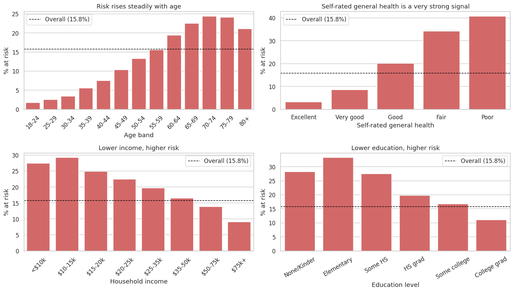
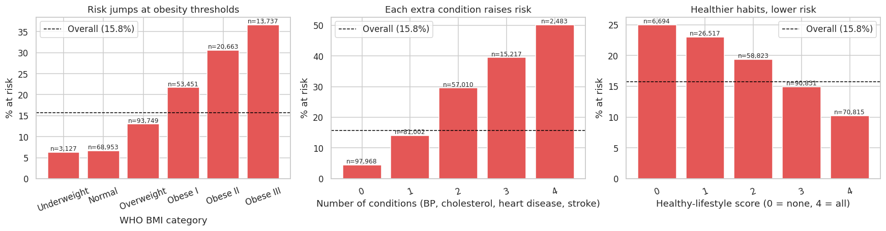
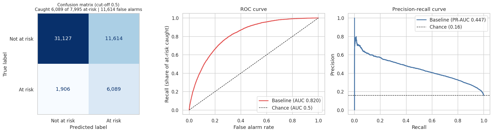

### Predicting Diabetes Risk from Everyday Health Survey Data

**Author:** Tayfun Yugruk

*Capstone initial report: exploratory data analysis, feature engineering and baseline model.*

#### Executive summary

This project asks whether simple health and lifestyle survey answers, with no blood tests, can identify people at risk of diabetes or prediabetes, and which factors matter most. Using about 250,000 responses from the CDC's 2015 national health survey, the exploratory analysis shows clear, steady risk patterns: risk rises with age, BMI, worse self-rated health, high blood pressure and high cholesterol, and falls with higher income, education and physical activity.

A tuned **baseline model (logistic regression)** already ranks people by risk correctly about **82% of the time** (ROC-AUC 0.820), compared with 50% for guessing. At a cut-off that catches about **80% of at-risk people**, it flags 38% of the population, roughly **3 people tested for every at-risk person found**, versus about 6 if people were chosen at random. Four engineered features gave a small but consistent improvement. In Module 24 this baseline will be compared with random forest, gradient boosting and a deep neural network.

#### Rationale

According to the CDC's National Diabetes Statistics Report, about **38.4 million Americans have diabetes, 8.7 million of whom are undiagnosed, and 97.6 million adults have prediabetes**, the stage at which lifestyle changes can still prevent or delay the disease ([CDC](https://www.cdc.gov/diabetes/data/statistics-report/index.html)). Blood tests are the reliable way to find it, but testing everyone is expensive and many people are never tested. If this problem goes unaddressed, screening and prevention programs keep relying on broad, untargeted outreach: resources go to people unlikely to benefit, and many at-risk people are found only once the disease is advanced and costly to treat. A tool that uses a few simple questions to decide **who to invite for a blood test first** would make prevention programs more efficient.

#### Research Question

Can a deep neural network, using basic health and lifestyle survey responses, accurately identify people at risk of diabetes or prediabetes, and which factors drive that risk the most?

*(This initial report builds the baseline. The deep neural network and other models are compared against it in Module 24.)*

#### Data Sources

CDC **Behavioral Risk Factor Surveillance System (BRFSS) 2015**, published on Kaggle as the *Diabetes Health Indicators Dataset*: <https://www.kaggle.com/datasets/alexteboul/diabetes-health-indicators-dataset> (file `diabetes_012_health_indicators_BRFSS2015.csv`, included in `data/`).

- **253,680 respondents, 21 features:** blood pressure, cholesterol, BMI, smoking, stroke, heart disease, physical activity, fruit and vegetable intake, heavy drinking, healthcare coverage and cost barriers, self-rated general, mental and physical health, difficulty walking, sex, age band, education and income.
- **Target:** 0 = no diabetes, 1 = prediabetes, 2 = diabetes.
- All answers are **self-reported**, and there are **no lab values**.

#### Methodology

**Data cleaning** (Notebook 1)
- **Missing values:** none.
- **Validity checks:** all binary columns contain only 0/1, and all values are whole numbers.
- **Target:** prediabetes and diabetes merged into one **at-risk** label (15.8% of respondents). The goal is screening, and prediabetes alone is only 1.8% of the data.
- **Duplicates kept (23,899 rows):** they are almost all healthy people giving common answers, and 1,804 identical answer profiles include both outcomes, so they are different people. Removing them would distort the sample; a sensitivity check confirms the conclusions do not change.
- **BMI capped at 60:** 805 respondents affected; no rows deleted.

**Exploratory data analysis** (Notebook 1)
- Distributions and risk rates by group.
- Spearman correlations.
- Statistical tests with effect sizes: chi-square with odds ratios and Cramér's V for yes/no features, and Mann-Whitney U with rank-biserial correlation for numeric features. With 250,000 rows almost everything is "significant", so effect sizes were used to judge importance.

**Feature engineering** (Notebook 1)
- `BMI_category`: WHO BMI bands, one-hot encoded for the model.
- `n_conditions`: count of high blood pressure, high cholesterol, heart disease and stroke.
- `lifestyle_score`: active + fruit + vegetables + non-smoker.
- `age_x_bmi`: an age × BMI interaction.

**Baseline model** (Notebook 2)
- **Model:** logistic regression with class weights (to handle the 84/16 imbalance) and standard scaling inside a pipeline.
- **Tuning:** `GridSearchCV` with stratified 5-fold cross-validation over the regularization type (L1/L2) and strength (C).
- **Split:** 80% training / 20% test, stratified, `random_state=42`. The test set was used only once, for the final evaluation.
- **Feature comparison:** the model was tuned with and without the engineered features. The engineered version was kept only because it improved results in every cross-validation fold, a rule set before looking at the test set.

**Evaluation metric:** **ROC-AUC** is the primary metric, because it measures how well the model ranks at-risk people above others regardless of the cut-off, and it is not fooled by class imbalance. Accuracy is not used: a model that says "nobody is at risk" is 84% accurate but finds no one. **PR-AUC, recall** (share of at-risk people caught, the key quantity for screening) and **precision** are also reported.

**Changes since Module 16:** the dataset and research question are unchanged. Decisions made during this phase: a binary at-risk target (the proposal left binary vs. 3-class open), duplicate rows kept after analysis, and four engineered features added.

#### Results

**1. What the data reveals (EDA)**



- **Imbalanced target:** only about 1 in 6 respondents is at risk.
- **Clear gradients:** risk climbs from about 2% at ages 18-24 to about 24% at 70-74. It climbs from about 3% for people who rate their health "excellent" to about 40% for "poor". It falls steadily as income and education rise.
- **Strongest single associations:** self-rated general health, high blood pressure (27% at risk vs. 7% without), BMI, difficulty walking, high cholesterol and age. No single feature is decisive: the strongest correlation with the target is only about 0.30, which is why combining features in a model is needed.
- **Some associations reflect how the data was collected, not causes:**
  - Heavy drinkers appear *less* at risk, probably because people diagnosed with diabetes are advised to stop drinking.
  - People with a recent cholesterol check or health coverage appear *more* at risk, because contact with doctors leads to diagnosis.
  - The labels record *diagnosed* conditions, so undiagnosed people count as "not at risk".

**2. Feature engineering**



- **Number of conditions:** risk rises from about 4% with none to about 50% with all four. At a correlation of 0.31, this is the strongest single variable in the dataset.
- **BMI bands:** risk is flat from underweight to normal weight (about 6-7%), then jumps at each obesity band, up to about 37%.
- **Age × BMI:** this interaction (correlation 0.29) is more strongly related to risk than age or BMI alone.

**3. Baseline model**

| Model | Cross-validated ROC-AUC | Test ROC-AUC | Test PR-AUC | Recall | Precision |
|---|---|---|---|---|---|
| Always predict "not at risk" (reference) | n/a | 0.500 | 0.158 | 0% | n/a |
| Logistic regression, 21 original features | 0.819 | 0.818 | 0.442 | 76% | 34% |
| **Logistic regression + engineered features (baseline)** | **0.820** | **0.820** | **0.447** | **76%** | **34%** |

*Recall and precision at the default 0.5 cut-off.*



- **The baseline is far better than guessing** and generalizes well: test and cross-validation scores match, and training and validation scores are nearly identical, so it is **not overfitting**.
- **Feature engineering helps slightly but reliably:** +0.0016 ROC-AUC in cross-validation, improving in all 5 folds, and +0.002 on the test set.
- **Screening trade-off** (cut-offs chosen on training data, then applied to the test set):

| Goal: catch about... | People flagged | Tests per at-risk person found |
|---|---|---|
| 70% of at-risk people | 30% | 2.7 |
| **80% of at-risk people** | **38%** | **3.0** |
| 90% of at-risk people | 52% | 3.6 |

- **Most important factors** (logistic regression odds ratios): general health, the age × BMI interaction, BMI, number of conditions, high blood pressure, high cholesterol and age raise risk; higher income lowers it. Because several features overlap, individual coefficients should be read as groups of related factors rather than precise effects.
- **Duplicate-row check:** removing duplicates lowers the score to 0.804, because the removed rows are mostly easy, common profiles. It does not change any conclusion.

#### Next steps

For Module 24:
1. **More models:** train and tune random forest, gradient boosting and a **deep neural network**, and compare them with this baseline on the same test set, with bootstrap confidence intervals to separate real differences from noise.
2. **Interactions:** test whether more flexible models learn interactions that the engineered features only partly capture.
3. **Fairness:** check whether the model works equally well across age, sex and income groups.
4. **Screening guidance:** recommend a cut-off based on screening capacity and identify the key drivers of risk.
5. **Presentation:** polish notebooks and this README for technical and non-technical audiences.

Known limitations to address in the final report: self-reported 2015 data with no lab values, labels that reflect only *diagnosed* conditions, and prediabetes merged with diabetes.

#### Outline of project

- [Notebook 1: Data cleaning, EDA and feature engineering](notebooks/01_EDA_Feature_Engineering.ipynb)
- [Notebook 2: Baseline model (logistic regression)](notebooks/02_Baseline_Model.ipynb)

Run the notebooks in order from the `notebooks/` folder after `pip install -r requirements.txt`. Run time on a single CPU core: about 1 minute for Notebook 1 and about 7 minutes for Notebook 2.

```
.
├── README.md
├── requirements.txt
├── data/diabetes_012_health_indicators_BRFSS2015.csv
├── notebooks/
│   ├── 01_EDA_Feature_Engineering.ipynb
│   └── 02_Baseline_Model.ipynb
└── images/          <- figures saved by the notebooks
```

##### Contact and Further Information

**Tayfun YUGRUK** | tayfunyugruk[at]gmail.com | https://www.linkedin.com/in/tayfunyugruk
